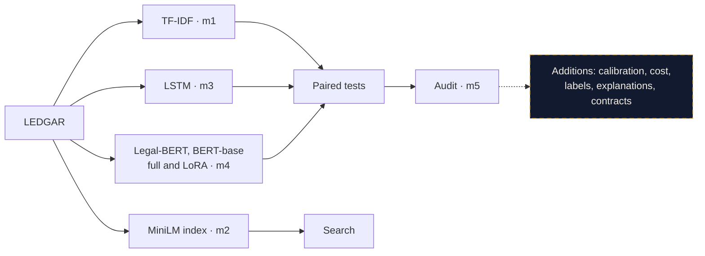

  <Stage />
  <ClauseField />
  

    <Headline text="Clausier" eyebrow="CONTRACT REVIEW, WITH THE EVIDENCE" />
    
Mathew Kristoffer Ewan KAPOOR · Wiyao TAKOUGNADI

    
Deep Learning for Sequential Data and NLP · Albert School · 23 October 2026

  

  <TypeClause clause="This Agreement shall be governed by the laws of the State of New York." label="Governing Laws" />
  <DeckFooter n="01" speaker="Wiyao" />
  

    
Sort every clause into {{ deck.label_distribution.names.length }} types

    
Find similar clauses from a question

    
Show where it works, and where it must not be trusted

  

<!--
**WIYAO · about 1 minute**

Good morning. Every contract review starts the same way: someone reads the contract and sorts it, clause by clause. Which one is the governing law, which one is the termination, and which one is missing. For a law firm, that is hours of expensive, repetitive reading.

Our client is a European legal-tech start-up. They asked us to build the language core of a contract-review assistant, and they asked for three things.

[click] First, sort every clause into one of the 100 clause types of the LEDGAR dataset.

[click] Second, find similar clauses in a clause bank, from a pasted clause or from a lawyer's question in plain English.

[click] Third, and they insisted on this: show the evidence. Where it works, where it fails, and what it must never be used for.

Ewan will start with the data.
-->

---

  <Stage />
  <Headline :text="`${deck.label_distribution.names.length} clause types, very unequal`" eyebrow="DATA" emphasis="unequal" />
  

    <EChart :option="distribution" height="475px" />
    

      
<CountUp :value="Object.values(deck.eda.split_sizes).reduce((sum, n) => sum + n, 0)" /> clauses

      
<strong>{{ integer(overlap) }}</strong> test clauses are near copies of training clauses.

      
Every result is also shown without them.

    

  

  <DeckFooter n="02" speaker="Ewan" />

<!--
**EWAN · about 40 seconds**

The data is LEDGAR, from the LexGLUE benchmark: 80,000 clauses from contracts filed with the US Securities and Exchange Commission, split into 60,000 for training, 10,000 for validation and 10,000 for test.

The chart shows the main difficulty: the 100 types are very unequal. Governing Laws has 3,167 training clauses, Books only 23. A model can look good on accuracy while failing every rare type, so our headline metric is macro-F1, which gives every type the same weight.

We also found that 2,241 test clauses are copies or near copies of training clauses. So every result is reported twice: on the full test set, and on the 7,759 clauses left once those copies are removed.
-->

---
transition: deck-iris | deck-sweep-back
---

  <Stage />
  <PipelineMotion />
  <Headline text="The course pipeline, end to end" eyebrow="PIPELINE" emphasis="pipeline" />

  

    
{{ deck.results_table.length }} trained models

    
Main comparison and audit plan written before the runs

    
Every number produced by a script

  

  <DeckFooter n="03" speaker="Ewan" />

<!--
**EWAN · about 40 seconds**

This is our pipeline, and it follows the course checkpoints. TF-IDF with logistic regression is the baseline, checkpoint m1. An LSTM trained from scratch is m3. The fine-tuned transformers, Legal-BERT and BERT-base, with full fine-tuning and with LoRA, are m4. The MiniLM sentence-embedding index for search is m2, and the bias audit is m5. On top, our own additions: calibration, cost, label overlap, explanations and contract checks.

[click] In total we trained 8 models.

[click] Before running anything, we committed our prediction for the main comparison and our audit plan, with their decision rules. So we could not adjust the story to the results.

[click] And every number you will see is produced by a script in the repository.
-->

---
transition: deck-rise | deck-sweep-back
---

  <Stage />
  <Headline text="TF-IDF and Legal-BERT are tied" eyebrow="RESULTS" emphasis="tied" />
  

    
TF-IDF<strong><CountUp :value="tfidf.test_macro_f1" :decimals="3" /></strong>

    ≈
    
Legal-BERT<strong><CountUp :value="legalBert.test_macro_f1" :decimals="3" /></strong>

  

  
McNemar p = {{ comparison.p_value.toFixed(2) }}, difference {{ comparison.diff_macro_f1.toFixed(3) }} [{{ comparison.diff_low.toFixed(3) }}, {{ comparison.diff_high.toFixed(3) }}]

  
<EChart :option="resultOption" height="265px" />
Bright bar: full test set · dim bar: without near copies

  
Predicted before the runs: Legal-BERT ahead by {{ deck.planned_advantage_points[0] }} to {{ deck.planned_advantage_points[1] }} points Wrong. Our rule: recommend the cheaper TF-IDF.

  <DeckFooter n="04" speaker="Ewan" />

<!--
**EWAN · about 1 minute 10**

This is the main result. Our tuned TF-IDF baseline reaches a test macro-F1 of 0.826. Legal-BERT, a BERT model pre-trained on legal text and fine-tuned for up to 10 epochs, reaches 0.825.

They are tied. The paired McNemar test gives p = 0.20, and the bootstrap interval on the difference, from minus 0.010 to plus 0.011, contains zero. The conclusion is the same on the deduplicated test set.

Below, all 8 models. The LSTMs are about 8 points lower. LoRA trains only 0.34% of the weights and loses 1 to 2 points. And Legal-BERT beats the general BERT-base by 1.3 points, significantly: legal pre-training does help.

[click] Our written prediction said Legal-BERT would win by 1 to 3 points. That was wrong, and we report it as wrong. But we had also written the rule: if Legal-BERT does not significantly beat TF-IDF on the deduplicated test set, recommend the cheaper model. So we recommend TF-IDF.
-->

---

  <Stage />
  <Headline text="State of the art, and far ahead of ChatGPT" eyebrow="POSITIONING" emphasis="ChatGPT" />
  <EChart :option="positionOption" height="420px" />
  
+{{ Math.round(tfidf.test_macro_f1 * 100 - deck.chatgpt_zero_shot.macro_f1) }}<small>macro-F1 points for our TF-IDF over ChatGPT zero-shot</small>

  
ChatGPT figures: Chalkidis 2023, gpt-3.5-turbo, {{ deck.chatgpt_zero_shot.source.match(/[\d,]+ LEDGAR/)?.[0].replace(' LEDGAR', '') }} test clauses. Published: LexGLUE, ACL 2022.

  <DeckFooter n="05" speaker="Wiyao" />

<!--
**WIYAO · about 40 seconds**

How does this compare with the state of the art? The LexGLUE benchmark publishes results on this exact test set: 83.0 macro-F1 for their Legal-BERT. Ours reaches 82.5, with the same 88.2 micro-F1, while reading 256 tokens instead of 512. And our TF-IDF beats their published TF-IDF baseline.

Then the question every client asks: why not just use ChatGPT? A 2023 study tested it on the same task: 56.7 macro-F1 without examples, and even lower with examples. Our classifier is 26 points ahead.

To be fair, newer models may do better. But ours answers in milliseconds, offline, always with one of the 100 types, and no contract ever leaves the client's machine.
-->

---

  <Stage />
  <Headline text="Ask a question, get the clauses" eyebrow="RETRIEVAL" emphasis="clauses" />
  

    <ClauseCloud />
    

      
Right type at rank 1, {{ lawyer.dense.n }} lawyer questions

      
MiniLM<strong>{{ lawyer.dense.rank1 }}</strong><i :style="{ width: `${lawyer.dense.rank1 / lawyer.dense.n * 100}%`, background: '#2dd4bf' }" />

      
TF-IDF<strong>{{ lawyer.tfidf.rank1 }}</strong><i :style="{ width: `${lawyer.tfidf.rank1 / lawyer.tfidf.n * 100}%`, background: '#d4a853' }" />

      
Keyword overlap<strong>{{ lawyer.overlap.rank1 }}</strong><i :style="{ width: `${lawyer.overlap.rank1 / lawyer.overlap.n * 100}%`, background: '#475569' }" />

    

  

  <DeckFooter n="06" speaker="Wiyao" />

<!--
**WIYAO · about 1 minute**

The second part of the product is search. We embedded the 60,000 training clauses with MiniLM, a sentence-transformer from the course, and we search by cosine similarity, exactly as in lab 3.

What you see is a 3D projection of real clauses, coloured by type: each colour group is one kind of clause. When a lawyer types a question, here "termination clauses with a 30-day notice period", the question lands in the same space, next to the clauses that mean the same thing. The five closest are listed: four termination clauses and one notice clause.

We tested 18 questions written the way a lawyer writes them. MiniLM finds the right clause type in first position 13 times out of 18. TF-IDF manages 10, and simple keyword overlap only 6.
-->

---
transition: deck-iris | deck-sweep-back
---

  <Stage />
  <Headline text="The right method depends on the query" eyebrow="RETRIEVAL, BY HAND" emphasis="query" />
  

    
<h2>From a clause</h2>
<strong>TF-IDF {{ f1(metrics.tfidf.deduplicated.top_1_accuracy[0]) }}</strong> vs MiniLM {{ f1(metrics.dense.deduplicated.top_1_accuracy[0]) }} top-1

    
<h2>From a question</h2>
<strong>MiniLM {{ lawyer.dense.rank1 }}/{{ lawyer.dense.n }}</strong> vs TF-IDF {{ lawyer.tfidf.rank1 }}/{{ lawyer.tfidf.n }}

  

  

    
“which court has jurisdiction over disputes”

    
“The parties agree irrevocably to submit to the exclusive jurisdiction of the federal courts ... located in Boston, Massachusetts”

    
Venuescounted wrongA lawyer would accept it: the same-label check is strict.

  

  
Filter: {{ days }} daysDurations in the question filter the results.

  <DeckFooter n="07" speaker="Wiyao" />

<!--
**WIYAO · about 50 seconds**

The lesson: the right method depends on the query. When the query is itself a clause, TF-IDF is slightly ahead, 0.787 against 0.771 for the first result, because a clause shares its exact wording with clauses of the same type. When the query is a question, MiniLM wins, because a question shares meaning, not words.

[click] We also read the results by hand. Our automatic score counts an answer as right only if it carries the same label. For "which court has jurisdiction over disputes", MiniLM returns a clause where the parties submit to the courts of Boston. It is labelled Venues, so it counts as wrong, but a lawyer would accept it. Our measure is strict, so the real quality is higher.

Durations in a question, like 30 days, also filter the results automatically.

Back to Ewan, for what all this costs.
-->

---
transition: deck-rise | deck-sweep-back
---

  <Stage />
  <Headline :text="`Same quality, ${integer(speed)}× faster`" eyebrow="COST" :emphasis="`${integer(speed)}×`" />
  
Time to classify {{ integer(tf.n * 10) }} clauses

  <TimeRace />
  

Training: {{ integer(deck.tfidf_train_seconds) }} s on a laptop CPU vs {{ Math.floor(legalBert.train_time_min / 60) }} h {{ Math.round(legalBert.train_time_min % 60) }} on a GPU

int8 Legal-BERT: {{ sizeRatio.toFixed(1) }} times smaller but slower on this laptop, and {{ qualityDrop.toFixed(1) }} points lower

  <DeckFooter n="08" speaker="Ewan" />

<!--
**EWAN · about 50 seconds**

Same quality, so what about cost? This is the time to classify 10,000 clauses on our laptop. TF-IDF: under one second. Legal-BERT on the laptop's GPU: 2 minutes 13. On its CPU: 5 minutes 18. TF-IDF is about 360 times faster, for the same quality.

Training tells the same story: 44 seconds on a laptop CPU for TF-IDF, more than two hours on a GPU for Legal-BERT.

We also tried compressing Legal-BERT to 8-bit integers. It becomes 2.4 times smaller, but on this laptop it is slower and 1.2 points less accurate, so it does not pay off here.

For a start-up, this difference is servers, cost and latency.
-->

---

  <Stage />
  <Headline text="Robust to parties, laws and number formats" eyebrow="AUDIT" emphasis="Robust" />
  

    

{{ audit[row[0]].decision }}

<EChart :option="auditOption" height="420px" />
Party roles: {{ (audit.party_roles.flip_rate * 100).toFixed(1) }}%, just above the line, but no more than its control ({{ (audit.party_roles.ctrl_flip_rate * 100).toFixed(1) }}%): pass by the rule.

    
<strong>Known weakness</strong>
Lease contracts: accuracy {{ deck.lease_slice.accuracy.toFixed(3) }} against {{ deck.lease_slice.overall_accuracy.toFixed(3) }} overall.

Flagged for review.

  

  <DeckFooter n="09" speaker="Ewan" />

<!--
**EWAN · about 50 seconds**

Now the audit. A clause type should not change when you change who the parties are, which law is named, or how a number is written. So we edited test clauses: we swapped Buyer and Seller, moved the governing law from New York to England, and rewrote "thirty (30) days" as "30 days". Each edit has a control edit of the same size that should not matter.

The rule was fixed in advance: a test fails if more than 2% of predictions change and the change is clearly above its control. All three tests pass. Party roles sits just above 2%, but no higher than its control: the model reacts to any change of party words, not to which side holds the role.

The analysis by kind of contract still finds a real weakness: on lease contracts, accuracy drops to 0.684, against 0.882 overall. We flag it as a known limit.
-->

---

  <Stage />
  <Headline text="A fifth of the errors are the label set, not the model" eyebrow="OVERLAPPING LABELS" emphasis="fifth" />
  
<LabelMerge />

<CountUp :value="share" :decimals="0" suffix="%" />

of Legal-BERT errors removed after merging overlapping labels

Paired accuracy p = {{ taxonomy.paired_tests.test.p_value.toFixed(3) }} (exploratory)

Recommendation: review these {{ taxonomy.pairs.length }} pairs with the start-up's lawyers.

  <DeckFooter n="10" speaker="Ewan" />

<!--
**EWAN · about 50 seconds**

When we read the errors, many were not really errors. A clause like "This Agreement shall be governed by the laws of New York" appears in the data under two labels: Applicable Laws and Governing Laws. Applicable Laws is the worst class of both models, with an F1 between 0.24 and 0.30.

We found nine pairs like this, with a rule fixed before measuring: the pair must be among the ten most confused for both models, and the examples must show the same kind of clause. Merging them removes 22% of Legal-BERT's errors, and Applicable Laws jumps to 0.963.

This analysis was outside our original plan, so it does not change the recommendation. But it is a concrete message for the client: review these nine pairs with your lawyers before collecting more data.
-->

---
transition: deck-rise | deck-sweep-back
---

  <Stage />
  <Headline text="It knows when to ask a person" eyebrow="TRUST" emphasis="person" />
  
<Reliability />
<ReviewFlow />
TF-IDF: {{ handled.toFixed(0) }}% handled automatically, {{ (recommended.abstention.test_accuracy * 100).toFixed(1) }}% of them right; {{ human.toFixed(0) }}% sent to a person. Legal-BERT: {{ (trust.abstention.test_coverage * 100).toFixed(1) }}% handled automatically.

Prediction sets: {{ Math.round(trust.conformal.test_coverage * 100) }}% coverage with {{ trust.conformal.mean_set_size.toFixed(2) }} types per clause.

  <DeckFooter n="11" speaker="Ewan" />

<!--
**EWAN · about 50 seconds**

A legal tool must know when it is unsure. On the left, the confidence of Legal-BERT. Before correction, when it says 90%, it is right much less often than that. A single temperature parameter, fitted on validation data, brings the calibration error from 8.5% down to 3.1%, without changing a single prediction. TF-IDF was already well calibrated.

Then we chose a confidence threshold on validation data. On the test set, 83% of clauses are handled automatically, and 94.7% of those are right. The other 17% go to a person.

We also give prediction sets: instead of one answer, a small set of types that contains the right one 90% of the time, with about one type per clause on average. When the set has two types, it is most often one of our overlapping pairs.
-->

---
transition: deck-iris | deck-sweep-back
---

  <Stage />
  <Headline text="Demo" eyebrow="DEMO" emphasis="" />
  
<video v-if="demoVideo" :src="demoUrl" controls playsinline /><template v-else><h2>Live demo</h2>
http://127.0.0.1:5050

Classify · Search · Missing clauses · Stress tests · Evidence
</template>

  <DeckFooter n="12" speaker="Wiyao, then Ewan" />

<!--
**WIYAO, then EWAN · about 1 minute**

**WIYAO, search, about 25 seconds.** In the app (127.0.0.1:5050), press 2 for Search and click the "30-day termination" example. Say: "Here is a lawyer's question. The results are real clauses from the bank, each with its type and its similarity, and the filter on 30 days is applied automatically." Then hand over to Ewan.

**EWAN, about 35 seconds.** Press 1 for Classify, click "Governing law", then Classify clause. Say: "The clause type, the calibrated confidence, and the decision: handled automatically, or sent to a person. The highlighted words are the ones that drove the decision." Press 3 for Review, then Review contract. Say: "A whole contract, checked against twelve standard clause types. Governing law and severability are missing, and the model asks a person to check the clauses it is unsure of."

If the app does not respond, play the video or move on: everything in the demo is also in the slides.
-->

---

  <Stage />
  <Headline text="What we recommend to the start-up" eyebrow="RECOMMENDATION" emphasis="recommend" />
  

    
<b>1</b>TF-IDF to classify, with calibrated confidence and a person for the {{ human }}% it is unsure of

    
<b>2</b>MiniLM to search from a lawyer's question

    
<b>3</b>Review {{ deck.taxonomy.pairs.length }} overlapping label pairs before collecting more data

    
<b>4</b>Not for non-US contracts, never without human review: not legal advice

  

  <svg class="signature" viewBox="0 0 720 65" aria-hidden="true"><path d="M0 46 C120 51 220 34 330 42 S565 52 710 31" /><text x="370" y="35">Clausier</text></svg>
  
Code, results and model card: github.com/Exowz/clausier-ledgar

  <DeckFooter n="13" speaker="Ewan" />

<!--
**EWAN · about 40 seconds**

To conclude, what we recommend to the start-up.

[click] First, TF-IDF to classify. Same quality as Legal-BERT, 360 times cheaper, with calibrated confidence and a person for the 17% of clauses it is unsure of.

[click] Second, MiniLM to search, when the input is a lawyer's question.

[click] Third, review the nine overlapping label pairs before collecting more data: that is where many of the remaining errors are.

[click] And the limits: everything was trained on US contracts filed with the SEC. It is not for European or non-English contracts without a new evaluation, and never without human review. It is not legal advice.

Everything is reproducible from the repository, with the model card. Thank you, we are happy to take your questions.
-->

---

  <Stage />
  <Headline text="Backup: validation macro-F1 per epoch" eyebrow="BACKUP" emphasis="validation" />
  

  <DeckFooter n="Backup" speaker="Questions" />

<!--
**QUESTIONS · backup answers**

**Why train longer than the 2 to 4 epochs of the course?** Every 4-epoch run was still improving at its last epoch, as this chart shows. We added 10-epoch runs, as the LexGLUE benchmark does, and chose the best run on validation data only. Full fine-tuning levels off from epoch 7; LoRA was still improving at epoch 10.

**Why macro-F1?** The 100 types are very unequal; macro-F1 gives each type the same weight, so rare types count.

**Why Legal-BERT and not CamemBERT?** The contracts are in English; CamemBERT is a French model.

**Why remove near copies?** 2,241 test clauses are near copies of training clauses; they make every model look better than it is on new contracts.

**Is the tie robust?** Yes: no significant difference on the full test set (p = 0.20) or on the deduplicated one (p = 0.16).

**Why LoRA?** It trains 0.34% of the weights with a quarter of the memory, for 1 to 2 points of macro-F1.
-->
