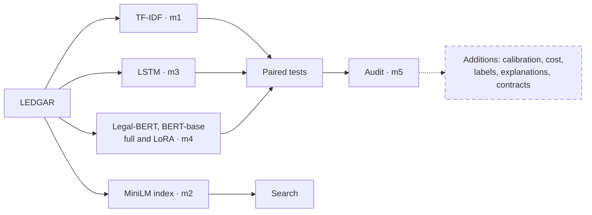

  

    
C

    <h1>Clausier</h1>
    
Contract clause review, with the evidence

    
Ewan · Wiyao TAKOUGNADI

    
Deep Learning for Sequential Data and NLP · Albert School · 23 October 2026

  

  <TypeClause clause="This Agreement shall be governed by the laws of the State of New York." label="Governing Laws" />
  

    
Sort every clause into {{ deck.label_distribution.names.length }} types

    
Find similar clauses from a question

    
Show where it works, and where it must not be trusted

  

<!--
Speaker: Wiyao. Budget: 1:00.
A start-up wants to help lawyers review large collections of contracts without hiding the evidence. Clausier sorts clauses, finds relevant examples, and makes its limits visible. We will show the product need, the measured results, and the decision we would make from them.
-->

---

  <h1>{{ deck.label_distribution.names.length }} clause types, very unequal</h1>
  

    <EChart :option="distribution" height="475px" />
    

      
<CountUp :value="Object.values(deck.eda.split_sizes).reduce((sum, n) => sum + n, 0)" /> clauses

      
<strong>{{ integer(overlap) }}</strong> test clauses are near copies of training clauses.

      
Every result is also shown without them.

    

  

  
Clausier · LEDGAR02

<!--
Speaker: Ewan. Budget: 0:40.
LEDGAR has a long tail of clause types, so accuracy alone can hide weak performance on rare types. Macro-F1 gives every type equal weight and is our headline measure. We also repeat the results after removing test clauses that are near copies of training clauses.
-->

---

  <h1>The course pipeline, end to end</h1>

  

    
{{ deck.results_table.length }} trained models

    
Main comparison and audit plan written before the runs

    
Every number produced by a script

  

  
Clausier · LEDGAR03

<!--
Speaker: Ewan. Budget: 0:40.
The work follows the course checkpoints from a simple classifier through retrieval and neural models to an audit. The main comparison and audit decisions were set before we looked at the final results. The additional analyses tell us what can be deployed and what still needs review.
-->

---

  <h1>TF-IDF and Legal-BERT are tied</h1>
  

    
<EChart :option="resultOption" height="450px" />
Test macro-F1: dark bar, full test set; light bar, without near copies

    

      

TF-IDF<strong><CountUp :value="tfidf.test_macro_f1" :decimals="3" /></strong>

Legal-BERT<strong><CountUp :value="legalBert.test_macro_f1" :decimals="3" /></strong>

      
McNemar p = {{ comparison.p_value.toFixed(2) }}

      
Difference {{ comparison.diff_macro_f1.toFixed(3) }} [{{ comparison.diff_low.toFixed(3) }}, {{ comparison.diff_high.toFixed(3) }}]

      
Predicted before the runs: Legal-BERT ahead by {{ deck.planned_advantage_points[0] }} to {{ deck.planned_advantage_points[1] }} points. Wrong. Our rule: then recommend the cheaper TF-IDF.

    

  

  
Clausier · LEDGAR04

<!--
Speaker: Ewan. Budget: 1:10.
We predicted that legal pretraining would put Legal-BERT ahead by one to three points. It did not: the two models have essentially identical macro-F1, including after near copies are removed. The paired test and uncertainty interval do not support a meaningful advantage for Legal-BERT. Our decision rule therefore points to TF-IDF.
-->

---

  <h1>State of the art, and far ahead of ChatGPT</h1>
  <EChart :option="positionOption" height="420px" />
  
ChatGPT figures: Chalkidis 2023, gpt-3.5-turbo, {{ deck.chatgpt_zero_shot.source.match(/[\d,]+ LEDGAR/)?.[0].replace(' LEDGAR', '') }} test clauses. Published: LexGLUE, ACL 2022.

  
Clausier · LEDGAR05

<!--
Speaker: Wiyao. Budget: 0:40.
Our best results are in the range of the published LexGLUE reference. The ChatGPT result here is an older gpt-3.5-turbo experiment on a smaller test set, so it is context rather than a direct contest with newer systems. Our classifiers answer offline in milliseconds and always return one of the supported clause types.
-->

---

  <h1>Ask a question, get the clauses</h1>
  

    <ClauseCloud />
    

      
Right type at rank 1, {{ lawyer.dense.n }} lawyer questions

      
MiniLM<strong>{{ lawyer.dense.rank1 }}</strong><i :style="{ width: `${lawyer.dense.rank1 / lawyer.dense.n * 100}%`, background: '#0f766e' }" />

      
TF-IDF<strong>{{ lawyer.tfidf.rank1 }}</strong><i :style="{ width: `${lawyer.tfidf.rank1 / lawyer.tfidf.n * 100}%`, background: '#14213d' }" />

      
Keyword overlap<strong>{{ lawyer.overlap.rank1 }}</strong><i :style="{ width: `${lawyer.overlap.rank1 / lawyer.overlap.n * 100}%`, background: '#9facb6' }" />

    

  

  
Clausier · LEDGAR06

<!--
Speaker: Wiyao. Budget: 1:00.
We embedded the clause bank with MiniLM and search it by cosine similarity. Each point is a real clause in the sampled projection, and the query arrives beside its nearest neighbours. On lawyer-written questions, the dense index finds the right type first more often than either comparison method. This is the retrieval checkpoint in the pipeline.
-->

---

  <h1>The right method depends on the query</h1>
  

    
<h2>From a clause</h2>
<strong>TF-IDF {{ f1(metrics.tfidf.deduplicated.top_1_accuracy[0]) }}</strong> vs MiniLM {{ f1(metrics.dense.deduplicated.top_1_accuracy[0]) }} top-1

    
<h2>From a question</h2>
<strong>MiniLM {{ lawyer.dense.rank1 }}/{{ lawyer.dense.n }}</strong> vs TF-IDF {{ lawyer.tfidf.rank1 }}/{{ lawyer.tfidf.n }}

  

  

    
“which court has jurisdiction over disputes”

    
“The parties agree irrevocably to submit to the exclusive jurisdiction of the federal courts ... located in Boston, Massachusetts”

    
Venues<s>counted wrong</s>A lawyer would accept it: the same-label check is strict.

  

  
Filter: {{ days }} daysDurations in the question filter the results.

  
Clausier · LEDGAR07

<!--
Speaker: Wiyao. Budget: 0:50.
When the query is itself a clause, TF-IDF narrowly leads on the deduplicated test. For a lawyer's natural question, MiniLM leads. A same-label score can mark a useful legal result wrong, as the venue example shows. I will hand over to Ewan for the deployment trade-off and audit.
-->

---

  <h1>Same quality, {{ integer(speed) }} times faster</h1>
  
Time to classify {{ integer(tf.n * 10) }} clauses

  <TimeRace />
  

Training: {{ integer(deck.tfidf_train_seconds) }} s on a laptop CPU vs {{ Math.floor(legalBert.train_time_min / 60) }} h {{ Math.round(legalBert.train_time_min % 60) }} on a GPU

int8 Legal-BERT: {{ sizeRatio.toFixed(1) }} times smaller but slower on this laptop, and {{ qualityDrop.toFixed(1) }} points lower

  
Clausier · LEDGAR08

<!--
Speaker: Ewan. Budget: 0:50.
The classification quality is tied, but the cost is not. For a large batch on this laptop CPU, TF-IDF finishes much sooner than Legal-BERT, even compared with the laptop GPU run. It also trains in seconds rather than hours. Quantization shrinks the BERT file but did not improve this laptop's speed.
-->

---

  <h1>Robust to parties, laws and number formats</h1>
  

    

{{ audit[row[0]].decision }}
<EChart :option="auditOption" height="420px" />
Party roles: {{ (audit.party_roles.flip_rate * 100).toFixed(1) }}%, just above the line, but no more than its control ({{ (audit.party_roles.ctrl_flip_rate * 100).toFixed(1) }}%): pass by the rule.

    
<strong>Known weakness</strong>
Lease contracts: accuracy {{ deck.lease_slice.accuracy.toFixed(3) }} against {{ deck.lease_slice.overall_accuracy.toFixed(3) }} overall.

Flagged for review.

  

  
Clausier · LEDGAR09

<!--
Speaker: Ewan. Budget: 0:50.
We used CheckList-style edits with controls and a decision rule fixed before the tests. All three edits pass that rule, including the party-role change that sits near the threshold. The slice audit still finds a serious weakness on lease contracts, so passing stress tests is not a general assurance.
-->

---

  <h1>A fifth of the errors are the label set, not the model</h1>
  
<LabelMerge />

<CountUp :value="share" :decimals="0" suffix="%" />

of Legal-BERT errors removed after merging overlapping labels

Paired accuracy p = {{ taxonomy.paired_tests.test.p_value.toFixed(3) }}

  
Recommendation: review these {{ taxonomy.pairs.length }} pairs with the start-up's lawyers.

  
Clausier · LEDGAR10

<!--
Speaker: Ewan. Budget: 0:50.
This was an exploratory analysis outside the original plan. Nine label pairs describe closely overlapping legal ideas, and merging them removes about a fifth of Legal-BERT's errors. The paired accuracy test shows a difference after merging. Lawyers should decide whether the distinctions are useful before we collect more examples.
-->

---

  <h1>It knows when to ask a person</h1>
  
<Reliability />

<strong><CountUp :value="handled" :decimals="0" suffix="%" /></strong>handled automatically, {{ (recommended.abstention.test_accuracy * 100).toFixed(1) }}% of them right<small>TF-IDF; Legal-BERT {{ (trust.abstention.test_coverage * 100).toFixed(1) }}%</small>

<strong><CountUp :value="human" :decimals="0" suffix="%" /></strong>sent to a person

Prediction sets: {{ Math.round(trust.conformal.test_coverage * 100) }}% coverage with {{ trust.conformal.mean_set_size.toFixed(2) }} types per clause.

  
Clausier · LEDGAR11

<!--
Speaker: Ewan. Budget: 0:50.
Temperature scaling is fitted on validation data, then checked on the test set. Legal-BERT's confidence is much closer to its observed accuracy after scaling; TF-IDF was already well calibrated. At the chosen threshold, some clauses still go to a person, and the prediction sets are usually very small. The figures are measured outcomes, not guarantees for a new contract population.
-->

---
transition: none
---

  <h1>Demo</h1>
  
<h2>Live demo</h2>
http://127.0.0.1:5050

Classify · Search · Missing clauses · Stress tests · Evidence

  
Clausier · LEDGAR12

<!--
Speaker: Wiyao for search, then Ewan. Budget: 1:00.
Wiyao enters a lawyer question and shows the matching clauses and their types. Ewan then shows classification confidence, a missing-clause check, and the evidence view. We keep the demo short so the decision and limits remain the closing message.
-->

---

  <h1>What we recommend to the start-up</h1>
  

    
TF-IDF to classify, with calibrated confidence and a person for the {{ human }}% it is unsure of

    
MiniLM to search from a lawyer's question

    
Review {{ deck.taxonomy.pairs.length }} overlapping label pairs before collecting more data

    
Not for non-US contracts, never without human review: not legal advice

  

  
Code, results and model card: github.com/Exowz/clausier-ledgar

  
Clausier · LEDGAR13

<!--
Speaker: Ewan. Budget: 0:40.
The business choice is the cheaper classifier with confidence and a person in the loop. We pair it with MiniLM when the input is a lawyer's question. Before expanding the dataset, we would have lawyers resolve the overlapping labels. This is for reviewed US contract work and is not legal advice.
-->

---

  <h1>Backup: validation macro-F1 per epoch</h1>
  
  
Clausier · LEDGARBackup

<!--
Backup for questions on training length. Every 4-epoch run was still rising at its last epoch, so we added the 10-epoch runs, decided on the validation curve only. Full fine-tuning levels off from epoch 7; LoRA is still rising at epoch 10. The 10-epoch run starts lower because its warmup lasts a whole epoch.
-->
